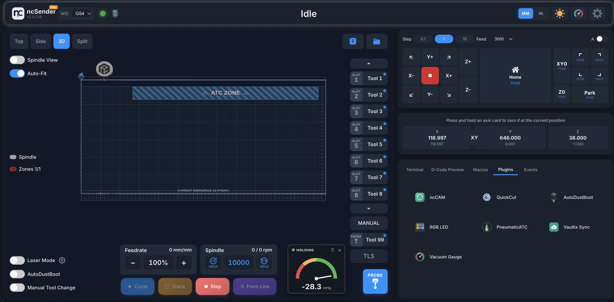
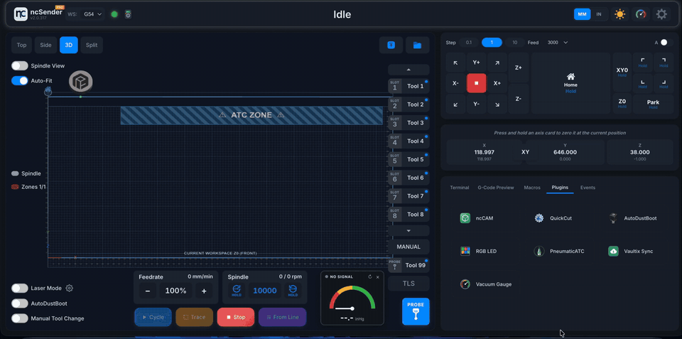
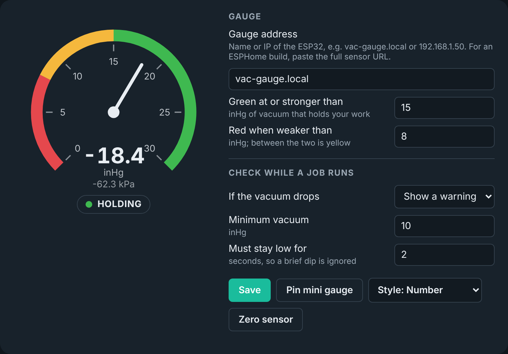
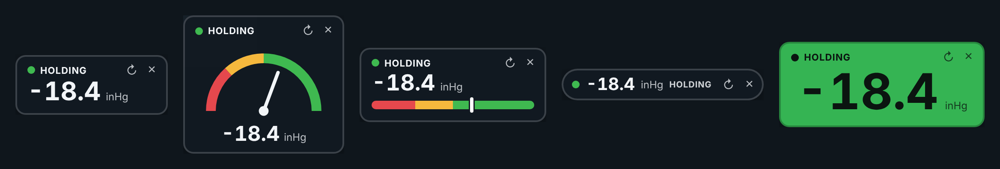
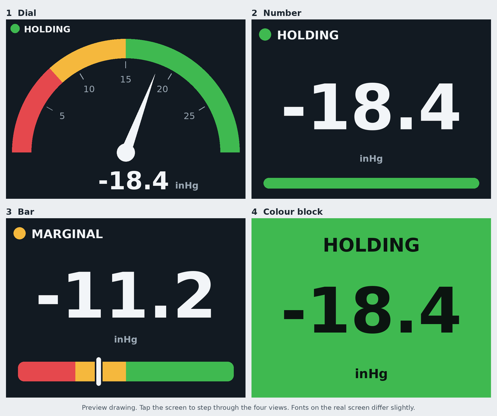

# Vacuum Gauge for ncSender

**Version 1.3.1** · [Download the latest release](https://github.com/Gedas-dev/ncsender-plugin-vacuum-gauge/releases/latest)

A WiFi vacuum gauge for a CNC vacuum table. An M5Stack ATOM Lite reads a pressure sensor on the vacuum line, and a plugin shows the reading inside [ncSender](https://github.com/siganberg/ncSender). If the vacuum drops during a job it can warn you, feed-hold, pause and park Z with the spindle stopped, or stop the job and raise Z.

The mini gauge is optional. Pin it and it stays on the main screen of every device, also after a restart and on remote browsers, until you unpin it. Drag it anywhere, pick one of five styles, and set its size with the Size slider. (Staying pinned everywhere needs ncSender Pro 2.0.317 or newer.)

## Parts

- M5Stack ATOM Lite (ESP32)
- M5Stack Tube / Air Pressure Unit (U130), -100 to 200 kPa
- USB-C data cable and 5 V USB power, or 5 V from the SLB-EXT through a USB-C cable: see page 3 of the [Install Guide (PDF)](docs/Vacuum-Gauge-Install-Guide.pdf)
- Silicone tube 2.5 x 4 mm, a 1/4" to 5/32" push-in reducer, 1/4" air tube, and a 1/4" tee

## Install

1. **Gauge:** plug the sensor into the ATOM's Grove port. Open [`firmware/VacGauge/VacGauge.ino`](firmware/VacGauge/VacGauge.ino) in Arduino IDE, type your WiFi name and password at the top, select board **M5Atom**, and upload.
2. **Plugin:** download the plugin zip from the [latest release](https://github.com/Gedas-dev/ncsender-plugin-vacuum-gauge/releases/latest). In ncSender open **Plugins -> Install from a ZIP file**. Do not unzip it.
3. **Set up:** open **Tools -> Vacuum Gauge**. With the pump off, click **Zero sensor**. Set your green and red levels and click **Save**.

### Use the IP address, not the name

Put the ATOM's IP address in **Gauge address**, for example `192.168.3.205`. The name `vac-gauge.local` has to be looked up again every few minutes, and on Windows that lookup can stall and drop the reading to NO SIGNAL for a few seconds.

To keep the address from changing, set a fixed one in the firmware: put it in `STATIC_IP` at the top of `VacGauge.ino` and upload. The gauge takes the gateway and network mask from the router. Pick an address no other device uses, or reserve it in the router.

Full steps with pictures: [Install Guide (PDF)](docs/Vacuum-Gauge-Install-Guide.pdf)

## Optional shop display

An M5Stack CoreS3 Lite can show the vacuum on its own screen, anywhere in the shop. It reads the gauge over WiFi and does not need ncSender running. Tap the screen to switch between four full-screen views: Dial, Number, Bar and Colour block.

Open [`firmware/VacDisplay/VacDisplay.ino`](firmware/VacDisplay/VacDisplay.ino) in Arduino IDE, install the **M5Unified** library, type your WiFi details and the gauge's IP address at the top, select board **M5CoreS3**, and upload.

## Notes

- Tested on a real machine with ncSender Pro 2.0.318.
- Needs ncSender 2.0.225 or newer (ncSender Pro 2.0.316 or newer).
- Feed hold stops the movement, but **the spindle keeps turning**. "Pause + park Z" needs parking enabled in the controller ($41). This is an operator aid, not a safety device.
- When you first set up "Pause + park Z" or "Stop job + raise Z", try it in air: no bit, and Z well above the table.

## Contributors

- [Gedas-dev](https://github.com/Gedas-dev): plugin and firmware
- [dehoutwinkel](https://github.com/dehoutwinkel) (Daryl): hardware design and build instructions

## Licence

GPL-3.0. See [LICENSE](LICENSE).
