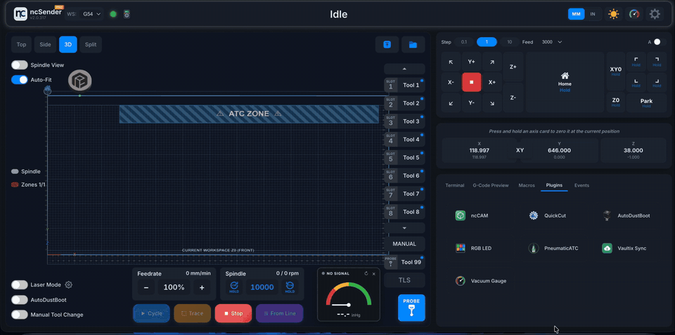
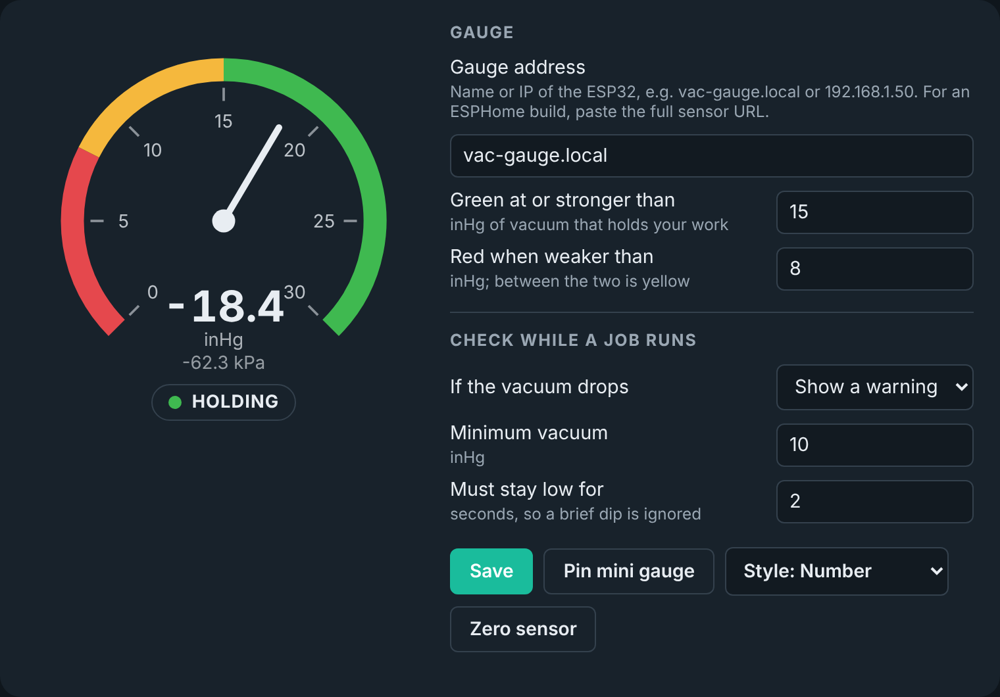
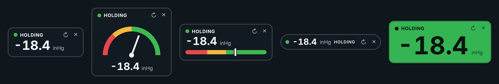

# Vacuum Gauge for ncSender

**Version 1.2.0** · [Download the latest release](https://github.com/Gedas-dev/ncsender-plugin-vacuum-gauge/releases/latest)

A WiFi vacuum gauge for a CNC vacuum table. An M5Stack ATOM Lite reads a pressure sensor on the vacuum line, and a plugin shows the reading inside [ncSender](https://github.com/siganberg/ncSender). If the vacuum drops during a job it can warn you, feed-hold, pause and park Z with the spindle stopped, or stop the job and raise Z.

The mini gauge is optional. Pin it and it floats on the main screen: drag it anywhere, for example over the visualizer, and pick one of five styles. Unpin it to use only the Vacuum Gauge window.

## Parts

- M5Stack ATOM Lite (ESP32)
- M5Stack Tube / Air Pressure Unit (U130), -100 to 200 kPa
- USB-C data cable and 5 V USB power
- Silicone tube 2.5 x 4 mm, a 1/4" to 5/32" push-in reducer, 1/4" air tube, and a 1/4" tee

## Install

1. **Gauge:** plug the sensor into the ATOM's Grove port. Open [`firmware/VacGauge/VacGauge.ino`](firmware/VacGauge/VacGauge.ino) in Arduino IDE, type your WiFi name and password at the top, select board **M5Atom**, and upload.
2. **Plugin:** download the plugin zip from the [latest release](https://github.com/Gedas-dev/ncsender-plugin-vacuum-gauge/releases/latest). In ncSender open **Plugins -> Install from a ZIP file**. Do not unzip it.
3. **Set up:** open **Tools -> Vacuum Gauge**. With the pump off, click **Zero sensor**. Set your green and red levels and click **Save**.

If the dial says NO SIGNAL, type the ATOM's IP address in **Gauge address**.

Full steps with pictures: [Install Guide (PDF)](docs/Vacuum-Gauge-Install-Guide.pdf)

## Notes

- Needs ncSender 2.0.225 or newer (ncSender Pro 2.0.316 or newer).
- Feed hold stops the movement, but **the spindle keeps turning**. "Pause + park Z" needs parking enabled in the controller ($41). This is an operator aid, not a safety device.
- Try "Pause + park Z" and "Stop job + raise Z" in air first, with no bit and Z well above the table.

## Credits

The hardware (M5Stack ATOM Lite with the Tube Pressure Unit, and the tube and fitting setup) and the build instructions come from [dehoutwinkel](https://github.com/dehoutwinkel). Thank you for sharing them.

## Licence

GPL-3.0. See [LICENSE](LICENSE).
